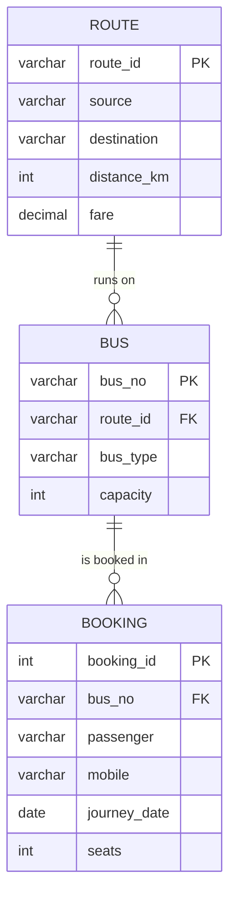
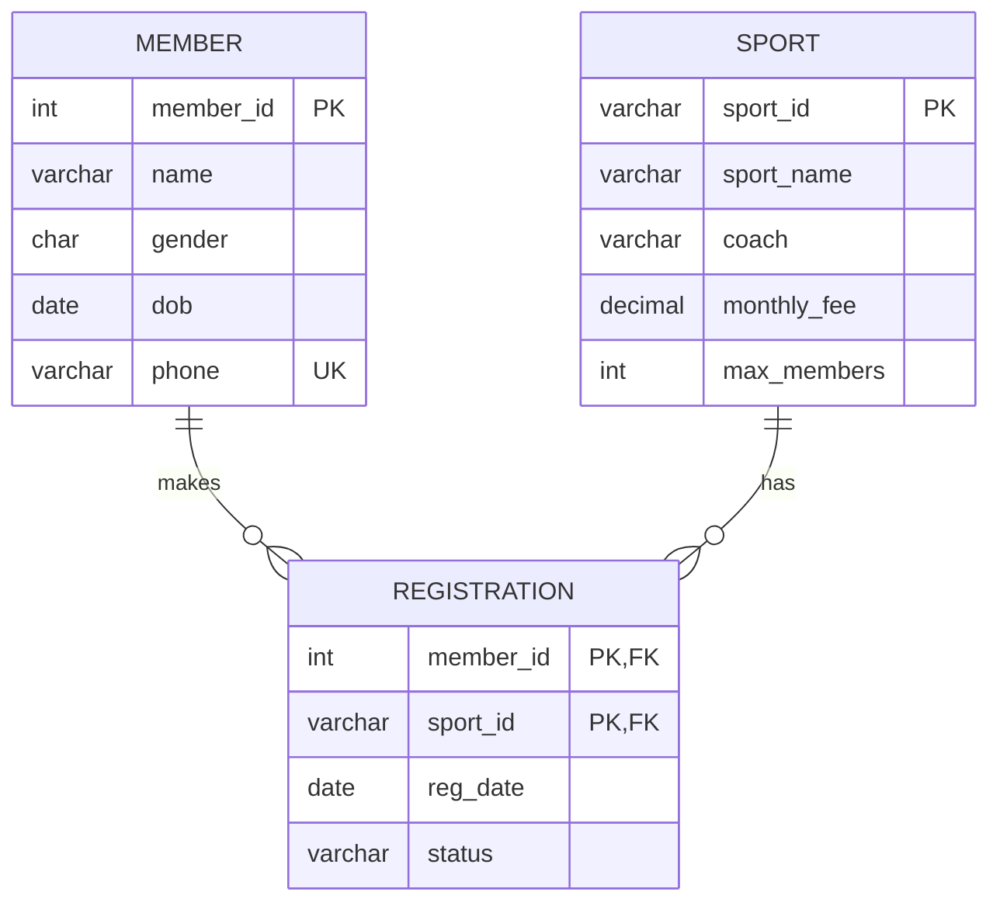
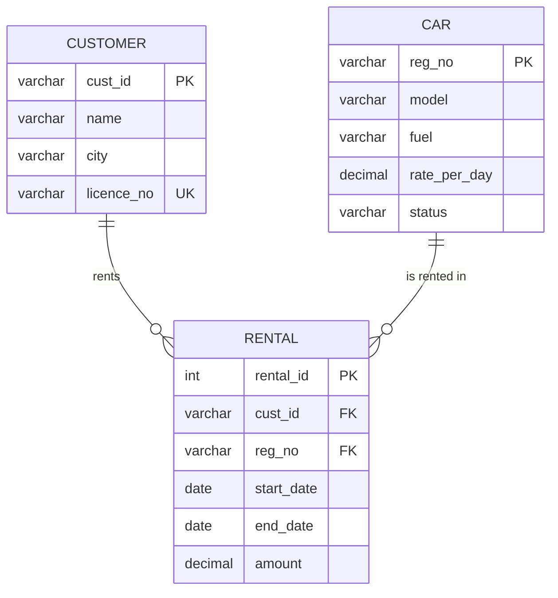

# Experiment 1 — SQL commands (DDL, DML, DCL), ER modelling, integrity constraints
Platform: MySQL 8. Run with `mysql -u root -p` (or Workbench). Slips: **1A Bus reservation, 1B Sports club, 1C Car rental**.

> Note: in the PDF the bus number is printed as `MH10-AB1001` in the Booking table by a layout glitch; the correct value is `MH10-AB-1001` (as in the Bus table).

---
# Slip 1A — Bus reservation

## Q1. ER diagram

Entities: Route, Bus, Booking (rectangles). Relationships: Route 1—M Bus, Bus 1—M Booking (diamonds "runs on", "booked in"). Underline PKs; draw FK on the "many" side.

## Q2. Create tables
```sql
CREATE DATABASE IF NOT EXISTS busDB;
USE busDB;

CREATE TABLE Route (
  route_id     VARCHAR(5) PRIMARY KEY,
  source       VARCHAR(30) NOT NULL,
  destination  VARCHAR(30) NOT NULL,
  distance_km  INT,
  fare         DECIMAL(8,2),
  CONSTRAINT chk_fare CHECK (fare > 0)
);

CREATE TABLE Bus (
  bus_no    VARCHAR(20) PRIMARY KEY,
  route_id  VARCHAR(5),
  bus_type  VARCHAR(20),
  capacity  INT,
  FOREIGN KEY (route_id) REFERENCES Route(route_id)
);

CREATE TABLE Booking (
  booking_id    INT PRIMARY KEY,
  bus_no        VARCHAR(20),
  passenger     VARCHAR(50) NOT NULL,
  mobile        VARCHAR(10),
  journey_date  DATE,
  seats         INT,
  FOREIGN KEY (bus_no) REFERENCES Bus(bus_no)
);
```

## Q3. Insert and display
```sql
INSERT INTO Route VALUES ('R1','Sangli','Pune',230,450),
                         ('R2','Kolhapur','Mumbai',380,700),
                         ('R3','Sangli','Goa',260,550);

INSERT INTO Bus VALUES ('MH10-AB-1001','R1','AC Sleeper',36),
                       ('MH09-CD-2002','R2','Non-AC Seater',45),
                       ('MH10-EF-3003','R3','AC Seater',40);

INSERT INTO Booking VALUES (1,'MH10-AB-1001','Rohan Patil','9876500001','2026-11-20',2),
                           (2,'MH09-CD-2002','Snehal Kadam','9876500002','2026-11-21',1),
                           (3,'MH10-AB-1001','Akash More','9876500003','2026-11-20',3);

SELECT * FROM Route;
SELECT * FROM Bus;
SELECT * FROM Booking;
```

## Q4. Foreign key error
```sql
INSERT INTO Booking VALUES (4,'MH12-ZZ-9999','Test User','9876500004','2026-11-22',1);
-- ERROR 1452 (23000): Cannot add or update a child row: a foreign key constraint fails
```
Reason: `MH12-ZZ-9999` does not exist in parent table `Bus` (referential integrity).

## Q5. ALTER – add column
```sql
ALTER TABLE Booking ADD COLUMN email VARCHAR(50);
DESC Booking;
```

## Q6. Increase fare of Sangli routes by 10 %
```sql
UPDATE Route SET fare = fare * 1.10 WHERE source = 'Sangli';
SELECT * FROM Route;      -- R1 = 495.00, R3 = 605.00
```

## Q7. Passenger name, bus number, destination
```sql
SELECT bk.passenger, bk.bus_no, r.destination
FROM Booking bk
JOIN Bus b   ON bk.bus_no = b.bus_no
JOIN Route r ON b.route_id = r.route_id;
```

## Q8. Delete booking 2
```sql
DELETE FROM Booking WHERE booking_id = 2;
SELECT * FROM Booking;
```

## Q9. User, GRANT, REVOKE (DCL)
```sql
CREATE USER 'conductor'@'localhost' IDENTIFIED BY 'Cond@123';
GRANT SELECT ON busDB.Booking TO 'conductor'@'localhost';
SHOW GRANTS FOR 'conductor'@'localhost';
REVOKE SELECT ON busDB.Booking FROM 'conductor'@'localhost';
SHOW GRANTS FOR 'conductor'@'localhost';
```

## Q10. Copy, TRUNCATE, DROP
```sql
CREATE TABLE Booking_copy LIKE Booking;
INSERT INTO Booking_copy SELECT * FROM Booking;
SELECT * FROM Booking_copy;
TRUNCATE TABLE Booking_copy;          -- removes all rows, keeps structure (DDL, no rollback)
SELECT * FROM Booking_copy;           -- empty set
DROP TABLE Booking_copy;              -- removes structure too
SHOW TABLES;
```

---
# Slip 1B — Sports club

## Q1. ER diagram

Member and Sport have an M:N relationship, resolved by the associative table Registration (composite PK = member_id + sport_id).

## Q2. Create tables
```sql
CREATE DATABASE IF NOT EXISTS clubDB;
USE clubDB;

CREATE TABLE Member (
  member_id INT PRIMARY KEY,
  name      VARCHAR(50) NOT NULL,
  gender    CHAR(1),
  dob       DATE,
  phone     VARCHAR(10),
  CONSTRAINT uq_phone UNIQUE (phone)
);

CREATE TABLE Sport (
  sport_id     VARCHAR(5) PRIMARY KEY,
  sport_name   VARCHAR(30) NOT NULL,
  coach        VARCHAR(40),
  monthly_fee  DECIMAL(8,2),
  max_members  INT,
  CONSTRAINT chk_fee CHECK (monthly_fee > 0)
);

CREATE TABLE Registration (
  member_id  INT,
  sport_id   VARCHAR(5),
  reg_date   DATE,
  status     VARCHAR(10),
  PRIMARY KEY (member_id, sport_id),
  FOREIGN KEY (member_id) REFERENCES Member(member_id) ON DELETE CASCADE,
  FOREIGN KEY (sport_id)  REFERENCES Sport(sport_id)
);
```

## Q3. Insert and display
```sql
INSERT INTO Member VALUES
 (101,'Kunal Shinde','M','2004-03-12','9822100001'),
 (102,'Pooja Desai','F','2005-07-25','9822100002'),
 (103,'Rahul Jagtap','M','2003-11-02','9822100003'),
 (104,'Tanvi Chavan','F','2006-01-18','9822100004');

INSERT INTO Sport VALUES
 ('S1','Badminton','Mr. Sawant',800,20),
 ('S2','Swimming','Ms. Kulkarni',1500,15),
 ('S3','Table Tennis','Mr. Gaikwad',600,12);

INSERT INTO Registration VALUES
 (101,'S1','2026-07-01','Active'),
 (101,'S2','2026-08-10','Active'),
 (102,'S2','2026-07-15','Active'),
 (103,'S3','2026-06-20','Inactive'),
 (104,'S1','2026-09-05','Active');

SELECT * FROM Member;  SELECT * FROM Sport;  SELECT * FROM Registration;
```

## Q4. Duplicate phone error
```sql
INSERT INTO Member VALUES (105,'Test Member','M','2005-05-05','9822100001');
-- ERROR 1062 (23000): Duplicate entry '9822100001' for key 'Member.uq_phone'
```

## Q5. Add email
```sql
ALTER TABLE Member ADD COLUMN email VARCHAR(50);
```

## Q6. DEFAULT on status
```sql
ALTER TABLE Registration ALTER COLUMN status SET DEFAULT 'Active';
DESC Registration;
```

## Q7. Members registered for Badminton
```sql
SELECT m.name
FROM Member m
JOIN Registration r ON m.member_id = r.member_id
JOIN Sport s        ON r.sport_id  = s.sport_id
WHERE s.sport_name = 'Badminton';      -- Kunal Shinde, Tanvi Chavan
```

## Q8. Reduce Table Tennis fee by 10 %
```sql
UPDATE Sport SET monthly_fee = monthly_fee * 0.90 WHERE sport_name = 'Table Tennis';
SELECT * FROM Sport;                   -- 540.00
```

## Q9. Delete member 104
```sql
DELETE FROM Member WHERE member_id = 104;   -- child row in Registration is removed by ON DELETE CASCADE
SELECT * FROM Member;
SELECT * FROM Registration;
```
(Without `ON DELETE CASCADE` you must first run `DELETE FROM Registration WHERE member_id=104;`, otherwise error 1451.)

## Q10. User and privileges
```sql
CREATE USER 'coach1'@'localhost' IDENTIFIED BY 'Coach@123';
GRANT SELECT, UPDATE ON clubDB.Registration TO 'coach1'@'localhost';
REVOKE UPDATE ON clubDB.Registration FROM 'coach1'@'localhost';
SHOW GRANTS FOR 'coach1'@'localhost';   -- only SELECT remains
```

---
# Slip 1C — Car rental

## Q1. ER diagram


## Q2. Create tables
```sql
CREATE DATABASE IF NOT EXISTS rentalDB;
USE rentalDB;

CREATE TABLE Customer (
  cust_id     VARCHAR(5) PRIMARY KEY,
  name        VARCHAR(50) NOT NULL,
  city        VARCHAR(30),
  licence_no  VARCHAR(20),
  CONSTRAINT uq_lic UNIQUE (licence_no)
);

CREATE TABLE Car (
  reg_no        VARCHAR(20) PRIMARY KEY,
  model         VARCHAR(30),
  fuel          VARCHAR(15),
  rate_per_day  DECIMAL(8,2),
  status        VARCHAR(15),
  CONSTRAINT chk_rate CHECK (rate_per_day > 0)
);

CREATE TABLE Rental (
  rental_id   INT PRIMARY KEY,
  cust_id     VARCHAR(5),
  reg_no      VARCHAR(20),
  start_date  DATE,
  end_date    DATE,
  amount      DECIMAL(10,2),
  FOREIGN KEY (cust_id) REFERENCES Customer(cust_id),
  FOREIGN KEY (reg_no)  REFERENCES Car(reg_no)
);
```

## Q3. Insert and display
```sql
INSERT INTO Customer VALUES ('C01','Amit Joshi','Sangli','DL-1001'),
                            ('C02','Neha Pawar','Pune','DL-1002'),
                            ('C03','Sagar Mane','Satara','DL-1003');

INSERT INTO Car VALUES ('MH10-K-1111','Swift','Petrol',1800,'Available'),
                       ('MH10-K-2222','Nexon EV','Electric',2800,'Rented'),
                       ('MH09-L-3333','Innova','Diesel',3500,'Available'),
                       ('MH12-M-4444','City','Petrol',2500,'Maintenance');

INSERT INTO Rental VALUES (1,'C01','MH10-K-2222','2026-10-25','2026-10-28',8400),
                          (2,'C02','MH09-L-3333','2026-10-10','2026-10-12',7000),
                          (3,'C01','MH10-K-1111','2026-09-01','2026-09-05',7200);

SELECT * FROM Customer;  SELECT * FROM Car;  SELECT * FROM Rental;
```

## Q4. FK error
```sql
INSERT INTO Rental VALUES (4,'C09','MH10-K-1111','2026-11-01','2026-11-02',1800);
-- ERROR 1452 (23000): Cannot add or update a child row: a foreign key constraint fails
```

## Q5. Add km_driven with DEFAULT 0
```sql
ALTER TABLE Rental ADD COLUMN km_driven INT DEFAULT 0;
SELECT * FROM Rental;
```

## Q6. Change car status
```sql
UPDATE Car SET status = 'Available' WHERE reg_no = 'MH12-M-4444';
```

## Q7. Customer name, car model, amount
```sql
SELECT c.name, ca.model, r.amount
FROM Rental r
JOIN Customer c ON r.cust_id = c.cust_id
JOIN Car ca     ON r.reg_no  = ca.reg_no;
```

## Q8. Available cars
```sql
SELECT * FROM Car WHERE status = 'Available';
-- Swift, Innova and (after Q6) City
```

## Q9. User and privileges
```sql
CREATE USER 'fleet_manager'@'localhost' IDENTIFIED BY 'Fleet@123';
GRANT SELECT, INSERT ON rentalDB.Car TO 'fleet_manager'@'localhost';
REVOKE INSERT ON rentalDB.Car FROM 'fleet_manager'@'localhost';
SHOW GRANTS FOR 'fleet_manager'@'localhost';
```

## Q10. Rename table
```sql
RENAME TABLE Rental TO Car_Rental;
-- or: ALTER TABLE Rental RENAME TO Car_Rental;
SHOW TABLES;
```

---
### Viva quick points
- DDL: CREATE, ALTER, DROP, TRUNCATE, RENAME (auto-commit). DML: INSERT, UPDATE, DELETE, SELECT. DCL: GRANT, REVOKE. TCL: COMMIT, ROLLBACK, SAVEPOINT.
- Primary key = unique + NOT NULL; foreign key enforces referential integrity; UNIQUE allows NULLs; CHECK enforced in MySQL 8.0.16+.
- TRUNCATE vs DELETE: TRUNCATE is DDL, resets AUTO_INCREMENT, cannot use WHERE; DELETE is DML and can be rolled back.
