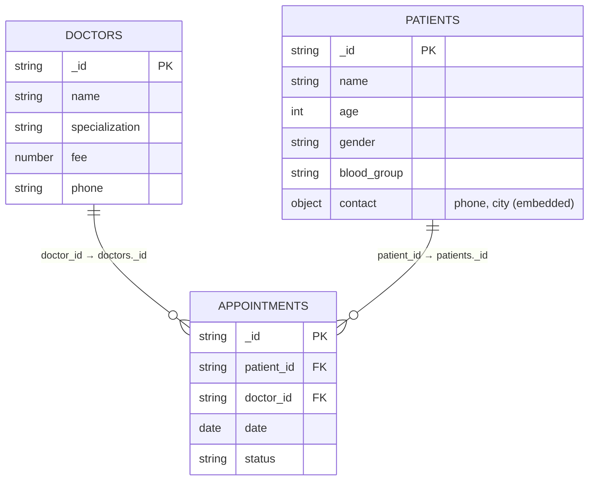

# Experiment 9 — Hospital management database (MongoDB, and MySQL connectivity from Python)
Platforms: MongoDB 7 with `mongosh` (9A, 9B); Python 3 + `mysql-connector-python` with MySQL 8 (9C).
Slips: **9A Patients, doctors and appointments · 9B Prescriptions and billing · 9C MySQL connectivity (Python)**.

---
# Slip 9A — Patients, doctors and appointments (database `appointmentDB`)

## Q1. Collection design (references)

Design: `contact` is **embedded** in patients (always read with the patient); appointments **reference** patients and doctors by `_id` (many appointments per patient/doctor).

## Q2. Create database and insert data
```js
use appointmentDB

db.doctors.insertMany([
  { _id: "D1", name: "Dr. Kavita Joshi", specialization: "Cardiology", fee: 800, phone: "9890200001" },
  { _id: "D2", name: "Dr. Sameer Patil", specialization: "ENT",        fee: 400, phone: "9890200002" },
  { _id: "D3", name: "Dr. Rekha Nair",   specialization: "Pediatrics", fee: 500, phone: "9890200003" }
])
db.patients.insertMany([
  { _id: "PA1", name: "Mahesh Kale",      age: 55, gender: "M", blood_group: "B+",  contact: { phone: "9765200001", city: "Sangli" } },
  { _id: "PA2", name: "Shruti Deshmukh",  age: 8,  gender: "F", blood_group: "O+",  contact: { phone: "9765200002", city: "Miraj" } },
  { _id: "PA3", name: "Ganesh Pawar",     age: 37, gender: "M", blood_group: "AB+", contact: { phone: "9765200003", city: "Tasgaon" } }
])
db.appointments.insertMany([
  { _id: "A201", patient_id: "PA1", doctor_id: "D1", date: ISODate("2026-11-04T10:00:00Z"), status: "Scheduled" },
  { _id: "A202", patient_id: "PA2", doctor_id: "D3", date: ISODate("2026-11-04T11:00:00Z"), status: "Scheduled" },
  { _id: "A203", patient_id: "PA3", doctor_id: "D2", date: ISODate("2026-11-03T12:30:00Z"), status: "Completed" },
  { _id: "A204", patient_id: "PA1", doctor_id: "D2", date: ISODate("2026-11-05T09:30:00Z"), status: "Scheduled" }
])
```

## Q3. $jsonSchema validation on patients
```js
db.runCommand({
  collMod: "patients",
  validator: { $jsonSchema: {
    bsonType: "object",
    required: ["name", "contact"],
    properties: {
      name: { bsonType: "string", description: "name is required" },
      contact: {
        bsonType: "object",
        required: ["phone"],
        properties: {
          phone: { bsonType: "string", pattern: "^[0-9]{10}$", description: "phone must be 10 digits" }
        }
      }
    }
  } },
  validationLevel: "strict",
  validationAction: "error"
})
```
(Alternative: create the collection with `db.createCollection("patients", { validator: {…} })` before inserting.)

## Q4. Insert patient without phone – validation error
```js
db.patients.insertOne({ _id: "PA4", name: "Test Patient", age: 30, gender: "M", contact: { city: "Sangli" } })
// MongoServerError: Document failed validation   (code 121)

db.patients.insertOne({ _id: "PA5", name: "Bad Phone", contact: { phone: "12345" } })   // also fails (not 10 digits)
```

## Q5. Doctors with fee above 450
```js
db.doctors.find({ fee: { $gt: 450 } })        // Dr. Kavita Joshi (800), Dr. Rekha Nair (500)
```

## Q6. Book a new appointment for PA3 with D1 on 2026-11-06
```js
db.appointments.insertOne({
  _id: "A205", patient_id: "PA3", doctor_id: "D1",
  date: ISODate("2026-11-06T10:00:00Z"), status: "Scheduled"
})
```

## Q7. Appointments with patient and doctor names ($lookup)
```js
db.appointments.aggregate([
  { $lookup: { from: "patients", localField: "patient_id", foreignField: "_id", as: "p" } },
  { $lookup: { from: "doctors",  localField: "doctor_id",  foreignField: "_id", as: "d" } },
  { $unwind: "$p" }, { $unwind: "$d" },
  { $project: { _id: 1, date: 1, status: 1, patient: "$p.name", doctor: "$d.name" } },
  { $sort: { date: 1 } }
])
```

## Q8. All appointments of Dr. Sameer Patil
```js
const doc = db.doctors.findOne({ name: "Dr. Sameer Patil" })
db.appointments.find({ doctor_id: doc._id })          // A203, A204
```

## Q9. Cancel appointment A202
```js
db.appointments.updateOne({ _id: "A202" }, { $set: { status: "Cancelled" } })
db.appointments.find({ _id: "A202" })
```

## Q10. Count appointments for each doctor
```js
db.appointments.aggregate([
  { $group: { _id: "$doctor_id", total: { $sum: 1 } } },
  { $lookup: { from: "doctors", localField: "_id", foreignField: "_id", as: "d" } },
  { $unwind: "$d" },
  { $project: { _id: 0, doctor: "$d.name", total: 1 } }
])
// Dr. Kavita Joshi 2 (A201, A205), Dr. Sameer Patil 2 (A203, A204), Dr. Rekha Nair 1 (A202)
```

---
# Slip 9B — Prescriptions and billing (database `billingDB`)

## Q1. Create database and insert all five collections
```js
use billingDB

db.doctors.insertMany([
  { _id: "DR7", name: "Dr. Anand Kulkarni", specialization: "Orthopedics", fee: 600 },
  { _id: "DR8", name: "Dr. Swati Mane",     specialization: "Gynecology",  fee: 700 }
])
db.patients.insertMany([
  { _id: "PB1", name: "Sunil Jagtap", age: 48, gender: "M", contact: { phone: "9765300001", city: "Kolhapur" } },
  { _id: "PB2", name: "Asha Kadam",   age: 31, gender: "F", contact: { phone: "9765300002", city: "Ichalkaranji" } },
  { _id: "PB3", name: "Vinod Shirke", age: 66, gender: "M", contact: { phone: "9765300003", city: "Kolhapur" } }
])
db.appointments.insertMany([
  { _id: "B301", patient_id: "PB1", doctor_id: "DR7", date: ISODate("2026-11-02T10:00:00Z"), status: "Completed" },
  { _id: "B302", patient_id: "PB2", doctor_id: "DR8", date: ISODate("2026-11-02T12:00:00Z"), status: "Completed" },
  { _id: "B303", patient_id: "PB3", doctor_id: "DR7", date: ISODate("2026-11-03T10:30:00Z"), status: "Completed" }
])
db.prescriptions.insertMany([
  { _id: "RX11", appointment_id: "B301", patient_id: "PB1", diagnosis: "Knee arthritis",
    medicines: [ { name: "Diclofenac 50", dose: "1-0-1", days: 10 }, { name: "Calcium 500", dose: "0-0-1", days: 30 } ] },
  { _id: "RX12", appointment_id: "B302", patient_id: "PB2", diagnosis: "Anaemia",
    medicines: [ { name: "Iron Folic Acid", dose: "0-1-0", days: 60 } ] },
  { _id: "RX13", appointment_id: "B303", patient_id: "PB3", diagnosis: "Back pain",
    medicines: [ { name: "Diclofenac 50", dose: "1-0-1", days: 5 }, { name: "Pantoprazole 40", dose: "1-0-0", days: 5 } ] }
])
db.billing.insertMany([
  { _id: "BL11", patient_id: "PB1", appointment_id: "B301",
    items: [ { desc: "Consultation", amount: 600 }, { desc: "X-ray", amount: 450 } ], total: 1050, status: "Paid" },
  { _id: "BL12", patient_id: "PB2", appointment_id: "B302",
    items: [ { desc: "Consultation", amount: 700 }, { desc: "Blood test", amount: 300 } ], total: 1000, status: "Pending" }
])
```

## Q2. $jsonSchema on billing
```js
db.runCommand({
  collMod: "billing",
  validator: { $jsonSchema: {
    bsonType: "object",
    required: ["patient_id", "appointment_id", "total", "status"],
    properties: {
      total:  { bsonType: "number", minimum: 0, exclusiveMinimum: true, description: "total must be > 0" },
      status: { enum: ["Paid", "Pending", "Cancelled"], description: "status must be Paid, Pending or Cancelled" }
    }
  } },
  validationLevel: "strict",
  validationAction: "error"
})
```

## Q3. Insert bill with total −200 – error
```js
db.billing.insertOne({
  _id: "BL99", patient_id: "PB3", appointment_id: "B303",
  items: [ { desc: "Refund", amount: -200 } ], total: -200, status: "Pending"
})
// MongoServerError: Document failed validation   (code 121)
```

## Q4. Prescription of PB1 with all medicines
```js
db.prescriptions.find({ patient_id: "PB1" }).pretty()
```

## Q5. $push 'Vitamin D3' to RX12
```js
db.prescriptions.updateOne(
  { _id: "RX12" },
  { $push: { medicines: { name: "Vitamin D3", dose: "0-0-1", days: 30 } } }
)
```

## Q6. Every medicine with the number of times prescribed ($unwind)
```js
db.prescriptions.aggregate([
  { $unwind: "$medicines" },
  { $group: { _id: "$medicines.name", times_prescribed: { $sum: 1 } } },
  { $sort: { times_prescribed: -1, _id: 1 } }
])
// Diclofenac 50 → 2; Calcium 500, Iron Folic Acid, Pantoprazole 40, Vitamin D3 → 1 each
```

## Q7. Generate a bill for B303 using the doctor's consultation fee
```js
const appt = db.appointments.findOne({ _id: "B303" })
const doc  = db.doctors.findOne({ _id: appt.doctor_id })        // Dr. Anand Kulkarni, fee 600

db.billing.insertOne({
  _id: "BL13",
  patient_id: appt.patient_id,
  appointment_id: appt._id,
  items: [ { desc: "Consultation", amount: doc.fee } ],
  total: doc.fee,
  status: "Pending"
})
db.billing.find({ _id: "BL13" })
```

## Q8. Pending bills with patient name and phone
```js
db.billing.aggregate([
  { $match: { status: "Pending" } },
  { $lookup: { from: "patients", localField: "patient_id", foreignField: "_id", as: "p" } },
  { $unwind: "$p" },
  { $project: { _id: 1, total: 1, patient: "$p.name", phone: "$p.contact.phone" } }
])
// BL12 Asha Kadam 9765300002 (1000), BL13 Vinod Shirke 9765300003 (600)
```

## Q9. Total collected (Paid) and total pending
```js
db.billing.aggregate([
  { $group: { _id: "$status", amount: { $sum: "$total" }, bills: { $sum: 1 } } }
])
// Paid 1050 (1 bill), Pending 1600 (2 bills: BL12 1000 + BL13 600)
```

## Q10. Mark BL12 as Paid and display all bills
```js
db.billing.updateOne({ _id: "BL12" }, { $set: { status: "Paid" } })
db.billing.find().pretty()
```

---
# Slip 9C — Hospital database with MySQL connectivity (Python)

## Q1. Install and connect, print server version
```bash
pip install mysql-connector-python
```
```python
import mysql.connector

conn = mysql.connector.connect(host="localhost", user="root", password="your_password")
print("Connected. MySQL server version:", conn.get_server_info())
conn.close()
```

## Complete program `hospital.py` (Q2 – Q10)
Change `PASSWORD` to your MySQL root password. Run `python hospital.py`.

```python
import mysql.connector
from mysql.connector import Error

HOST, USER, PASSWORD = "localhost", "root", "your_password"


def connect(db=None):
    return mysql.connector.connect(host=HOST, user=USER, password=PASSWORD, database=db)


# ---------------------------------------------------------------- Q2: create DB and tables
def create_schema():
    conn = connect()
    cur = conn.cursor()
    cur.execute("CREATE DATABASE IF NOT EXISTS hospitalDB")
    cur.execute("USE hospitalDB")
    cur.execute("""CREATE TABLE IF NOT EXISTS Doctor (
        doctor_id INT PRIMARY KEY, name VARCHAR(40), specialization VARCHAR(30),
        fee DECIMAL(8,2), phone VARCHAR(10))""")
    cur.execute("""CREATE TABLE IF NOT EXISTS Patient (
        patient_id INT PRIMARY KEY, name VARCHAR(40), age INT, gender CHAR(1),
        blood_group VARCHAR(3), phone VARCHAR(10), city VARCHAR(30))""")
    cur.execute("""CREATE TABLE IF NOT EXISTS Appointment (
        appt_id INT AUTO_INCREMENT PRIMARY KEY, patient_id INT, doctor_id INT,
        appt_date DATETIME, status VARCHAR(15),
        FOREIGN KEY (patient_id) REFERENCES Patient(patient_id),
        FOREIGN KEY (doctor_id)  REFERENCES Doctor(doctor_id))""")
    cur.execute("""CREATE TABLE IF NOT EXISTS Bill (
        bill_id INT AUTO_INCREMENT PRIMARY KEY, appt_id INT, patient_id INT,
        amount DECIMAL(10,2), status VARCHAR(10),
        CONSTRAINT chk_amount CHECK (amount > 0),
        FOREIGN KEY (appt_id)    REFERENCES Appointment(appt_id),
        FOREIGN KEY (patient_id) REFERENCES Patient(patient_id))""")
    conn.commit()
    print("Q2: database and 4 tables created")
    cur.close(); conn.close()


# ---------------------------------------------------------------- Q3 & Q4: insert data
def insert_data():
    conn = connect("hospitalDB")
    cur = conn.cursor()

    doctors = [(1, "Dr. Prakash Rao", "Neurology", 900, "9890400001"),
               (2, "Dr. Meenal Gokhale", "Dermatology", 500, "9890400002"),
               (3, "Dr. Ajit Sawant", "General Medicine", 300, "9890400003")]
    cur.executemany("INSERT INTO Doctor VALUES (%s,%s,%s,%s,%s)", doctors)

    patients = [(101, "Ravi Bhosale", 45, "M", "O+", "9765400001", "Satara"),
                (102, "Kalpana More", 38, "F", "A+", "9765400002", "Karad"),
                (103, "Tushar Jadhav", 22, "M", "B-", "9765400003", "Satara")]
    cur.executemany("INSERT INTO Patient VALUES (%s,%s,%s,%s,%s,%s,%s)", patients)

    appts = [(501, 101, 1, "2026-11-02 10:00:00", "Completed"),
             (502, 102, 2, "2026-11-02 11:00:00", "Completed"),
             (503, 103, 3, "2026-11-03 09:30:00", "Scheduled")]
    cur.executemany("INSERT INTO Appointment VALUES (%s,%s,%s,%s,%s)", appts)

    bills = [(9001, 501, 101, 1400, "Paid"), (9002, 502, 102, 500, "Pending")]
    cur.executemany("INSERT INTO Bill VALUES (%s,%s,%s,%s,%s)", bills)

    conn.commit()
    print("Q3/Q4: data inserted and committed")
    cur.close(); conn.close()


# ---------------------------------------------------------------- Q5: appointments with names
def show_appointments():
    conn = connect("hospitalDB")
    cur = conn.cursor()
    cur.execute("""SELECT a.appt_id, p.name, d.name, a.appt_date, a.status
                   FROM Appointment a
                   JOIN Patient p ON a.patient_id = p.patient_id
                   JOIN Doctor  d ON a.doctor_id  = d.doctor_id
                   ORDER BY a.appt_date""")
    print("\nQ5: Appointments")
    print(f"{'ID':<6}{'Patient':<18}{'Doctor':<22}{'Date':<22}{'Status'}")
    print("-" * 78)
    for appt_id, pname, dname, dt, status in cur.fetchall():
        print(f"{appt_id:<6}{pname:<18}{dname:<22}{str(dt):<22}{status}")
    cur.close(); conn.close()


# ---------------------------------------------------------------- Q6: book appointment (keyboard input)
def book_appointment():
    conn = connect("hospitalDB")
    cur = conn.cursor()
    pid = int(input("\nQ6: Enter patient_id: "))
    did = int(input("Enter doctor_id: "))
    dt = input("Enter date and time (YYYY-MM-DD HH:MM:SS): ")
    cur.execute("INSERT INTO Appointment (patient_id, doctor_id, appt_date, status) "
                "VALUES (%s, %s, %s, 'Scheduled')", (pid, did, dt))
    conn.commit()
    print("Appointment booked, appt_id =", cur.lastrowid)
    cur.close(); conn.close()


# ---------------------------------------------------------------- Q7: pending bills
def pending_bills():
    conn = connect("hospitalDB")
    cur = conn.cursor()
    cur.execute("""SELECT b.bill_id, p.name, p.phone, b.amount
                   FROM Bill b JOIN Patient p ON b.patient_id = p.patient_id
                   WHERE b.status = 'Pending'""")
    print("\nQ7: Pending bills")
    for bill_id, name, phone, amount in cur.fetchall():
        print(f"Bill {bill_id} | {name} | {phone} | Rs. {amount}")
    cur.close(); conn.close()


# ---------------------------------------------------------------- Q8: mark bill paid
def mark_paid():
    conn = connect("hospitalDB")
    cur = conn.cursor()
    cur.execute("UPDATE Bill SET status = %s WHERE bill_id = %s", ("Paid", 9002))
    conn.commit()
    print("\nQ8: rows affected =", cur.rowcount)          # 1
    cur.close(); conn.close()


# ---------------------------------------------------------------- Q9: transaction with forced error
def bill_transaction():
    conn = connect("hospitalDB")
    cur = conn.cursor()
    try:
        conn.start_transaction()
        # statement 1: generate bill for appointment 503 (Dr. Ajit Sawant, fee 300)
        cur.execute("INSERT INTO Bill (appt_id, patient_id, amount, status) VALUES (%s,%s,%s,%s)",
                    (503, 103, 300, "Pending"))
        # statement 2: forced error – wrong table name
        cur.execute("UPDATE Appointmnt SET status = 'Completed' WHERE appt_id = 503")
        conn.commit()
    except Error as e:
        print("\nQ9: error ->", e)
        conn.rollback()
        print("Rolled back: nothing changed")
    finally:
        cur.execute("SELECT COUNT(*) FROM Bill")
        print("Bills in table:", cur.fetchone()[0])         # still 2
        cur.execute("SELECT status FROM Appointment WHERE appt_id = 503")
        print("Appointment 503 status:", cur.fetchone()[0])  # still Scheduled
        cur.close(); conn.close()


# ---------------------------------------------------------------- Q10: error handling
def error_handling_demo():
    conn = cur = None
    try:
        conn = mysql.connector.connect(host=HOST, user=USER, password="wrong_password")   # wrong password
        cur = conn.cursor()
    except Error as e:
        print("\nQ10: connection error ->", e)              # 1045 Access denied
    finally:
        if cur: cur.close()
        if conn and conn.is_connected(): conn.close()

    conn = cur = None
    try:
        conn = connect("hospitalDB")
        cur = conn.cursor()
        cur.execute("SELECT * FROM Ward")                   # missing table
    except Error as e:
        print("Q10: query error ->", e)                     # 1146 Table 'hospitaldb.ward' doesn't exist
    finally:
        if cur: cur.close()
        if conn and conn.is_connected():
            conn.close()
            print("Cursor and connection closed in finally")


if __name__ == "__main__":
    create_schema()
    insert_data()
    show_appointments()
    book_appointment()
    show_appointments()
    pending_bills()
    mark_paid()
    pending_bills()                  # now empty
    bill_transaction()
    error_handling_demo()
```

### Expected key outputs
- Q5: three rows (Ravi/Dr. Prakash Rao, Kalpana/Dr. Meenal Gokhale, Tushar/Dr. Ajit Sawant) in aligned columns.
- Q7: `Bill 9002 | Kalpana More | 9765400002 | Rs. 500.00`.
- Q8: `rows affected = 1`.
- Q9: error 1146 (table `Appointmnt` doesn't exist) → rollback → Bill count unchanged (2) and appointment 503 still `Scheduled` (atomicity).
- Q10: `1045 (28000): Access denied for user 'root'@'localhost'` and `1146 (42S02): Table 'hospitaldb.ward' doesn't exist`.

---
### Viva quick points
- MongoDB: reference vs embedding; `$jsonSchema` validator (`required`, `bsonType`, `pattern`, `minimum`, `enum`); `$lookup`, `$unwind`, `$group`; validation error code 121.
- Python–MySQL: `connect()` → `cursor()` → `execute()/executemany()` → `commit()/rollback()` → `close()`.
- Use **parameterized queries** (`%s` placeholders) to prevent SQL injection; `cursor.rowcount`, `cursor.lastrowid`; `start_transaction()`; catch `mysql.connector.Error`.
